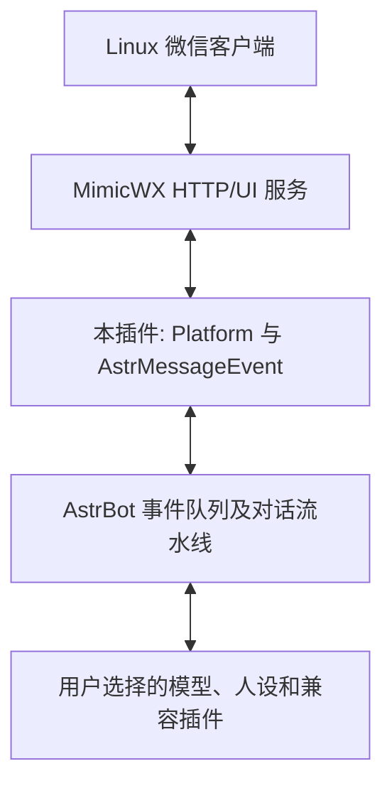

# 与开源项目的连接方式

先部署 AstrBot。这个仓库补充一个原生平台适配器，不另写一套对话引擎。



`@register_platform_adapter("mimicwx", ...)` 注册平台。`MimicWXAdapter` 实现连接、轮询、标准消息转换和主动会话发送；`MimicWXEvent.send()` 把 AstrBot 回复转换回 HTTP 发送。插件不改写 AstrBot 核心。

输入路径：`GET /listen/messages` → 精确会话允许列表 → 文本/身份规范化 → 消息ID去重和回声排除 → `AstrBotMessage`（`Plain`/`At`）→ AstrBot事件队列。

输出路径：AstrBot `MessageChain` → `MimicWXEvent.send()` 或 `send_by_session()` → `send_chain()` → `POST /send` / `POST /send_image`。所有出站目标必须来自已配置的群标识映射；模型文字不能新增目标。HTTP token 只通过认证头发送，不跟随HTTP跳转。

当前接口基线是 MimicWX `0.4.0` 的 HTTP/UI 形状，而不是假装微信消息是 QQ OneBot 消息。上游可能演进到其他实现，需逐项检查接口契约。

## 上游消息示例（合成数据）

```json
{
  "机器人测试群": [{
    "index": 8,
    "role": "list item",
    "children": [{"role": "label", "name": "@小助手 你好"}],
    "msg_id": "ui:synthetic-message-1",
    "msg_type": "friend",
    "sender": "合成群友甲",
    "content": "@小助手 你好"
  }]
}
```

有些客户端把真实文字气泡暴露为 `msg_type="sys"`、`role="list item"`、`children=[]`，并给出 `sender="SYS"`。这只能证明有文本，不能证明是谁发的；按 `unknown_sender_policy` 处理。收到的“图片”文字占位不会变成可看的图片。

`group_id = "wxg_" + sha256(会话名称UTF8)[:24]`。统一会话标识为 `<平台id>:GroupMessage:<group_id>`。这些都是本地生成的路由标识，**不是微信原生ID**。

## 去重及送达语义

- 首次轮询默认只标记积压消息，不回复。
- 消息ID按会话隔离，已见标识留在SQLite中约7天。旧式非`ui:`标识额外结合可见索引，缓解相邻重复文本的碰撞。
- 发文字前先保存约5分钟的规范化正文摘要，降低无法识别自己消息时的回声循环。相同的人类文本也可能被短时误过滤。
- 发送串行化以降低窗口/剪贴板竞争；命令已执行但 `verified=false` 时记录不确定状态，不自动重发。
- 消费接口、去重库、AstrBot事件队列及模型调用不在同一事务中。崩溃或重启可能造成消息丢失，不能承诺“恰好一次”。

## 数据与权限

自己的SQLite只存摘要/标识/时间；health只存计数及状态。但输入原文会作为事件交给 AstrBot，其他插件、日志和模型有各自的数据处理方式。请在实际部署中核验，不要把此处当作整套系统的“不记录聊天”保证。

本插件不授权模型执行系统命令，不附带模型适配或额度。但它与其他 Python 插件共享 AstrBot 进程权限，不能充当完整沙箱。
