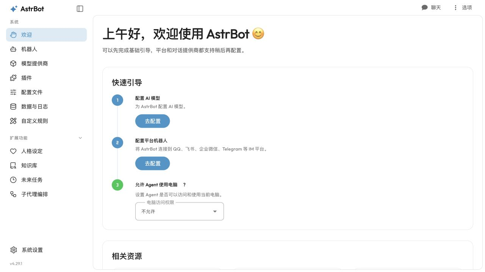
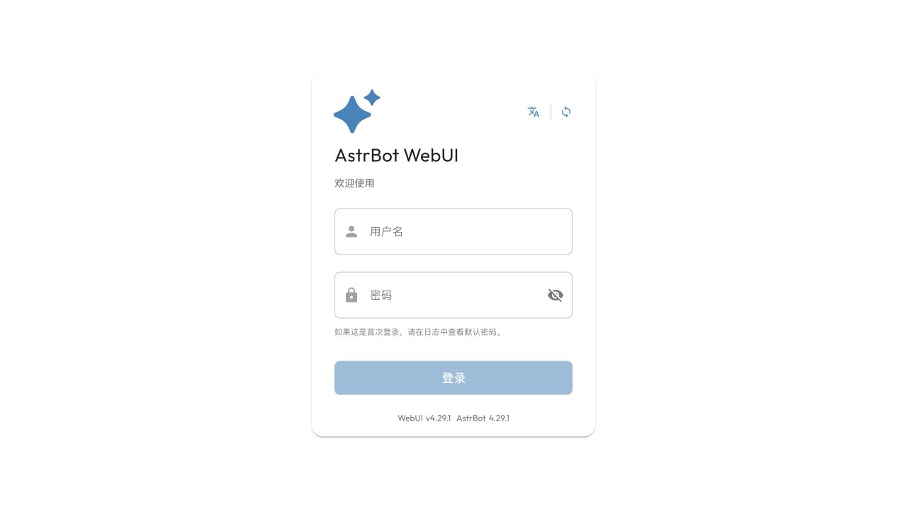
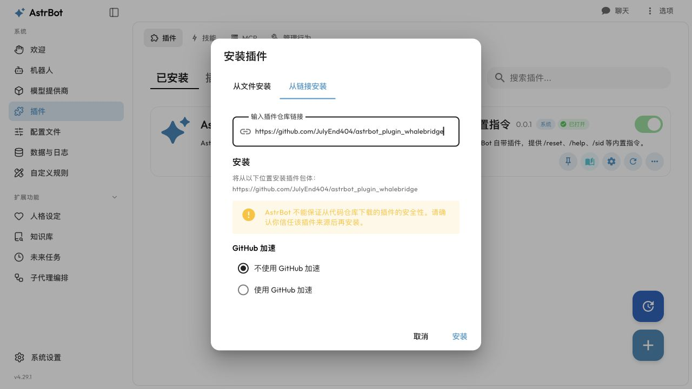
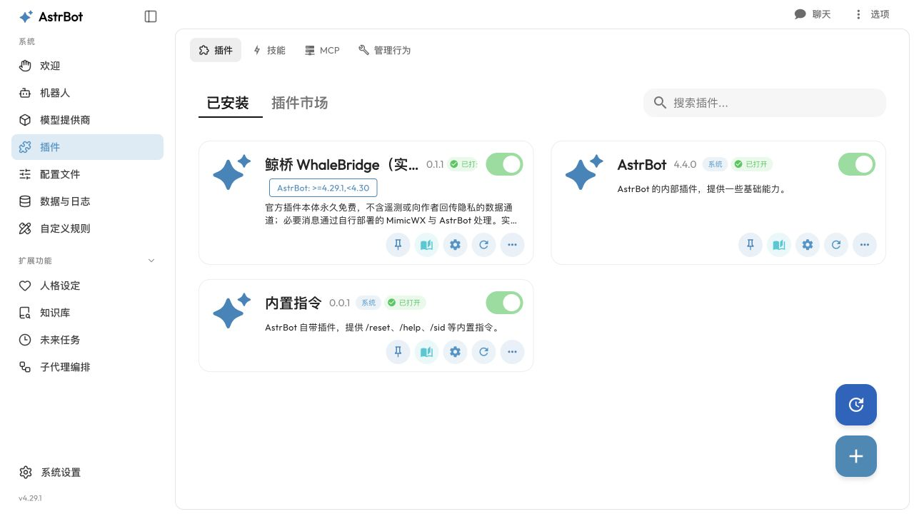
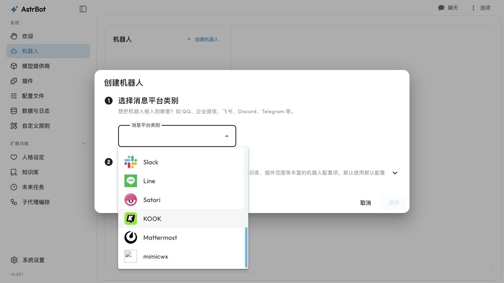
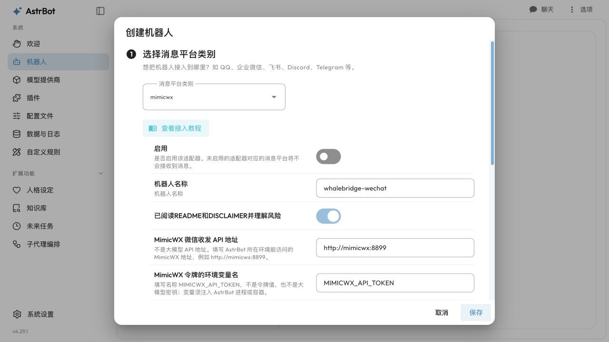
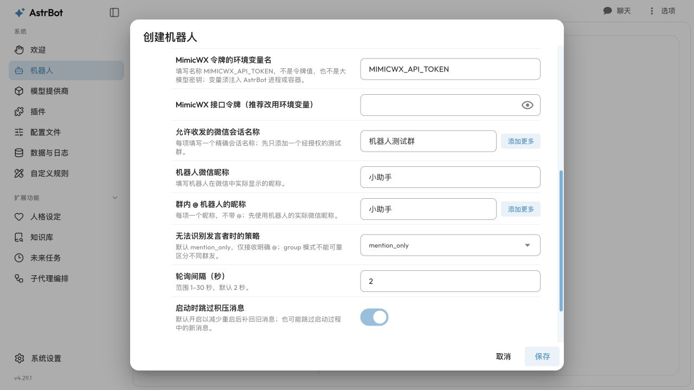
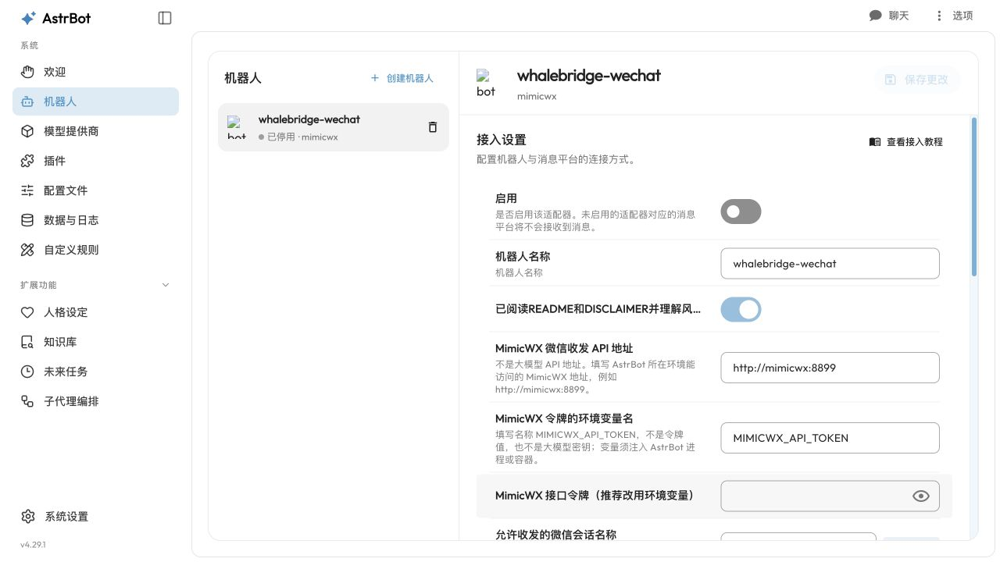
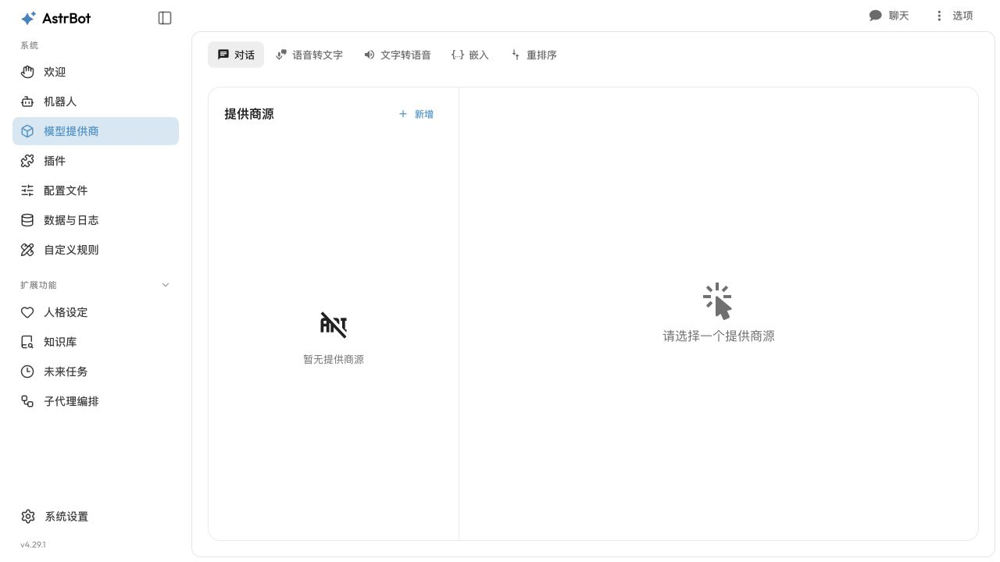
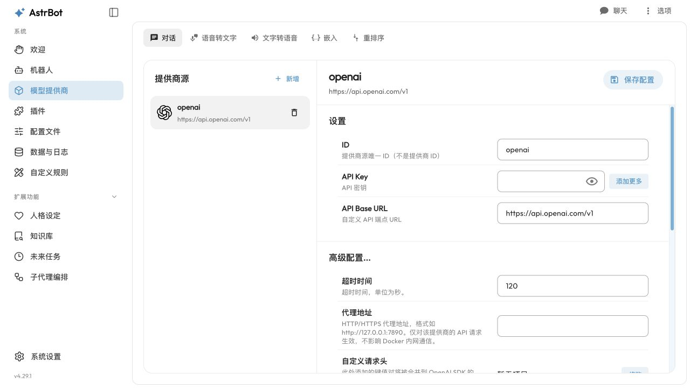

# 安装与使用图文教程

**先安装并运行 AstrBot，并配置好能完成普通对话的模型，再安装本插件。** 没有 AstrBot，单独下载本仓库不能启动微信机器人。请先读 [README 风险警告](../README.md) 和 [完整免责声明](../DISCLAIMER.md)。

本文截图于 **2026-10-21** 在独立的 **AstrBot 4.29.1** 教学环境中实际操作取得，覆盖从 GitHub 安装、选择平台、填写及保存配置的过程。截图中的群名、昵称和接口地址均为教学示例，不能直接用于你的部署。平台配置保持停用，未连接真实微信或大模型账号；这组截图不表示公开版已完成真实微信端到端验收。截图来源与验证范围见 [截图说明](images/install/README.md)。

建议按顺序阅读：[准备条件](#第一步确认准备条件) → [检查微信后端](#第二步先确认-mimicwx-接口) → [网络与令牌](#第三步让-astrbot-所在环境连到接口) → [安装插件](#第四步安装插件) → [填写平台](#第五步添加消息平台) → [模型与白名单](#第六步绑定模型人设和核心白名单) → [微信验收](#第七步实际验收)。

## 先分清：这两个 API 地址填在不同位置

**本教程的配置操作都在你自己的 AstrBot 后台进行，不存在需要注册或上传配置的“鲸桥网站”。**

| 配置项 | 在哪里填 | 作用 |
| --- | --- | --- |
| 大模型 API 地址、模型密钥、模型名称 | AstrBot → 模型提供商 | 让 AstrBot 调用你选择的大模型，生成回答 |
| MimicWX 微信收发 API 地址 `api_url` | AstrBot → 机器人 → 鲸桥平台配置 | 告诉鲸桥去哪里读取微信消息、发送回复，例如同一私有 Docker 网络中的 `http://mimicwx:8899` |
| MimicWX 接口令牌 | 放入 AstrBot 进程/容器的环境变量；鲸桥配置只填变量名 | 认证你自己的 MimicWX 收发接口，与模型密钥无关 |

消息路径为：**微信 ↔ MimicWX ↔ 鲸桥插件 ↔ AstrBot ↔ 你配置的大模型**。鲸桥不会自动部署或发现 MimicWX，也不替代 AstrBot 的模型配置；在 AstrBot 配好大模型后，仍需单独填写微信后端的地址。

在自己的 AstrBot 后台，左侧的「模型提供商」负责模型，「机器人」负责微信等消息通道。浏览器地址中的 `127.0.0.1:16188` 只是本次教学用的管理面板入口，**既不是大模型地址，也不是 MimicWX 地址**。



## 第一步：确认准备条件

- 已运行的 AstrBot；本版原生接口基线为 `4.29.1`，Python `3.12`。
- 鲸桥使用 **0.1.1 或更高的兼容版本**。0.1.0 的后台表单可能把列表保存为字符串；已安装旧版的用户请先更新、重启，并重新核对群名及 @ 昵称列表。
- 你有权操作的 Linux 微信账号，已在你控制的环境中登录。
- 独立部署、具备下述 HTTP 接口的 MimicWX 服务。请参考 [上游固定版本](https://github.com/wx-11/MimicWX-Linux/tree/a42a3eec4e6efa2d023915e980e9af7d5fcf9439) 及 [兼容性说明](COMPATIBILITY.md)。不要盲用最新分支或混用 OneBot 模式。
- 机器人已加入一个取得适当授权、无同名歧义的测试群；部署者已完成必要的参与者告知和权限评估。

本插件不安装微信、不提取数据库密钥、不处理扫码登录，也不附带模型密钥或免费额度。上游安装脚本、镜像权限和账号授权需要你另外核验。

用你自己的后台账号登录；不要把后台直接暴露到公网，也不要照抄截图中的端口。下图是本次实际使用的空白登录页，未包含密码。



## 第二步：先确认 MimicWX 接口

本插件期望：

| 接口 | 用途 | 是否消费消息 |
| --- | --- | --- |
| `GET /status` | 返回 `{"status":"已登录", ...}` | 否 |
| `GET /listen` | 返回已监听会话名称数组 | 否 |
| `POST /listen` | 用 `{"who":"精确会话名称"}` 添加监听 | 否，但会操作微信窗口 |
| `GET /listen/messages` | 返回 `{会话名称: [消息...]}` | **是，取走待处理消息** |
| `POST /send` | `{"to":"会话名称","text":"文字"}` | 执行发送 |
| `POST /send_image` | `{"to":"会话名称","file":"原始Base64","name":"image.gif"}` | 执行发送 |

发送返回至少包含 `sent: true/false`，通常还带 `verified`。消息结构见 [架构与接口](ARCHITECTURE.md)。

**不要在机器人运行时手动调用 `/listen/messages` 做测试，也不要再启动第二个监听程序。** 可以使用下面的只读检查工具；它只调用 `/status` 和 `/listen`，不发送或消费消息。

在安全环境内设置 `MIMICWX_API_TOKEN`，不要把值发到聊天、Issue 或公共命令记录中，然后运行：

```sh
python tools/check_transport.py --url http://127.0.0.1:8899
```

令牌应与 MimicWX 配置中的 token 一致。启用 token 认证，不要使用公开、弱口令或他人的接口。

## 第三步：让 AstrBot 所在环境连到接口

- 两者是同一宿主机上的普通进程：可使用 `http://127.0.0.1:8899`。
- AstrBot 在容器内：这里的 `127.0.0.1` 指 AstrBot 容器自身，不是宿主机或另一个容器。
- 两者在 Docker 中：推荐只把 AstrBot 服务接入 MimicWX 所在的现有私有网络，使用该网络内的服务名，例如 `http://mimicwx:8899`。

[Docker 扩展示例](../examples/compose.astrbot.override.yaml) 只是在**你原有 AstrBot Compose**上增加环境变量和已有网络，不负责创建 MimicWX。检查服务名、网络名，合并时保留原有卷、其他网络和设置，先备份配置及数据。

`.env.example` 只含占位符。复制到你私有的部署目录并填写，确保不提交 Git。`MIMICWX_API_TOKEN` 必须注入 **AstrBot 进程/容器**；仅在自己电脑的终端设置，不会自动传进云端容器。

不要为图方便发布 API、VNC 或管理端口到公网。跨不可信网络使用有效 HTTPS 和访问控制，不要关闭证书校验。

## 第四步：安装插件

1. 在 AstrBot 管理面板进入左侧 **插件**，打开「已安装」。
2. 点击右下角 **＋**，在「安装插件」弹窗切换到 **从链接安装**。
3. 填入下方仓库链接；本次实跑选择「不使用 GitHub 加速」，点击 **安装**。如果网络失败，先排查网络，不要随意把配置交给来历不明的加速站。

```text
https://github.com/JulyEnd404/astrbot_plugin_whalebridge
```



4. 等待安装结束。后台可能自动打开插件 README，读完关闭，核对插件卡片上的名称、版本及启用状态。完整图文教程建议在 GitHub 中阅读。
5. **重启 AstrBot 一次**，让新增平台出现在平台选择列表中。使用你原来的管理方式只重启 AstrBot 服务，保留数据卷；不需要删除微信登录数据。



插件卡片「已打开」只表示插件已加载，**不代表微信已登录、模型可用或通道已启用**。本教程后面还需要单独创建机器人。

如果已装 0.1.0，可在插件卡片「… → 重新安装」中检查更新。后台未检测到新版本时，可核对仍是本项目仓库，再选择「强制更新」。下载失败时不要把失败当成功；可由熟悉部署的人备份后手动更新插件目录，再重启 AstrBot。本次实跑的版本和下载情况见 [截图说明](images/install/README.md)。

开发者也可将仓库放到 AstrBot 的 `data/plugins/astrbot_plugin_whalebridge/` 中，按 AstrBot 官方文档安装依赖并重启。

## 第五步：添加消息平台

1. 进入左侧 **机器人 → 创建机器人**。
2. 打开「消息平台类别」，向下滚动，选择 **`mimicwx`**。在 AstrBot 4.29.1 的这个下拉框中，实际显示的是类别名 `mimicwx`，不是插件卡片的完整中文名。



3. 保持「启用」关闭，先填写下面的配置。所有项目都在这个 **AstrBot 机器人表单**内，不需要到另一个鲸桥网站注册。

| 参数 | 说明 |
| --- | --- |
| `id` | 例如 `whalebridge-wechat`；使用后不要随意更改，会影响会话及去重数据命名空间 |
| `enable` | 默认关闭；完成配置和风险评估后自行开启 |
| `risk_acknowledged` | 阅读风险后显式设为 `true`；它不能替代法律授权 |
| `api_url` | MimicWX 的 HTTP(S) origin；不得附带账号、密码、路径、查询参数或 fragment |
| `api_token_env` | 推荐 `MIMICWX_API_TOKEN`；填写环境变量**名称**，不是令牌值 |
| `api_token` | 仅在清空 `api_token_env` 后用作备用；不建议直接存真实令牌 |
| `groups` | 精确会话名称列表；最多30个，先只填一个授权测试群 |
| `self_name` | 机器人当前微信显示名 |
| `mention_names` | 群内 @ 机器人时出现的昵称列表；先使用实际显示名 |
| `unknown_sender_policy` | 默认 `mention_only`；其他选项的限制见下文 |
| `poll_interval` | 1–30秒，默认2秒 |
| `discard_startup_backlog` | 默认 `true`，启动跳过积压；这也可能丢掉启动过程中的新消息 |

**地址与令牌这样区分：** `api_url` 填你自己的 MimicWX 服务地址，例如私有 Docker 网络中可解析的 `http://mimicwx:8899`；不要填 DeepSeek/OpenAI 等模型地址。`api_token_env` 只填 `MIMICWX_API_TOKEN` 这个变量名，实际令牌按照第三步注入 AstrBot。保留变量名时，即使在备用 `api_token` 框里填写令牌，也不会绕过环境变量读取。



群名和 @ 昵称都是**列表**，先在输入框填第一项，增加第二项时点击旁边的「添加更多」，每个会话或昵称单独一项。不要把多个群名写成一段逗号分隔的文字，也不要把 JSON 数组当成一个昵称粘进去。示例「机器人测试群」和「小助手」应分别换成自己的精确群名及实际微信昵称。



4. 阅读 README 与免责声明，理解并接受风险后才勾选风险确认。点击 **保存**。先核对已保存的机器人卡片；准备好网络、令牌、模型及白名单后，再自行启用通道。



本次实跑另外核对了保存后的数据：`groups` 和 `mention_names` 为数组，风险确认与跳过积压为布尔值，轮询间隔为数值，并通过插件配置校验。**通过配置校验仍不等于已经连通微信。**

无真实凭据的完整样例见 [examples/platform.json](../examples/platform.json)。如果通过配置文件维护，应在停止 AstrBot 并备份后，将该对象合并进全局 `data/cmd_config.json` 的 `platform` 数组，**保留已有平台**，然后再启动。不同 profile 中的同名 `platform` 不是本插件的生效入口。

### 身份不明时怎么处理

- `drop`：丢弃所有无法识别发言者的消息。
- `mention_only`：默认。只接收明确 @；每条消息使用不同匿名标识，不保证按人续聊。
- `group`：允许身份未知消息参与群话题，共用一个匿名群标识。所有身份未知者在技术上会被当成同一主体，**不能**做可靠个人记忆、管理员识别或只回应最初呼叫者。

三个选项都不能修复真实微信 ID 的缺失。同名显示名也可能串人。启用任何个人记忆插件前必须单独核验；未知身份标记不会强制第三方插件停止存储。

## 第六步：绑定模型、人设和核心白名单

本插件只收发消息。模型、人设、上下文和回答风格在 AstrBot 中配置；可为该通道/群绑定自己的配置文件和人格。不要照搬别人的真实账号、群名单或模型登录数据。

**大模型 API 地址和密钥在左侧「模型提供商」中设置。** 如果你原来的 AstrBot 已能正常对话，可继续使用原模型配置，无需在鲸桥中重复填写。下图是干净教学环境的模型入口，未配置真实模型；不同模型供应商的创建表单可能不同。



以「新增 → OpenAI Compatible」表单为例，**API Key** 与 **API Base URL** 就在模型提供商页面。下图只打开了实际表单，没有填密钥、获取模型或发起模型对话；使用其他供应商时，请按供应商及 AstrBot 的说明填写，不要照抄截图中的默认模型地址，更不要把 MimicWX 令牌填到模型密钥处。



群标识根据名称的 UTF-8 字节生成。运行：

```sh
python tools/group_ids.py '机器人测试群'
```

将输出的 `group_id` 加到你启用的 AstrBot 核心 `platform_settings.id_whitelist`。不要为了连通而关闭全局白名单。若要按通道绑定配置，使用工具输出的 `unified_msg_origin`。

如果另外安装群聊增强插件，应按该插件说明，把同一个 `group_id` 加进它的允许群列表，核对唤醒词、概率、分段和数据保存行为。QQ专属的戳一戳、群管理或协议组件不保证在微信可用。本仓库不自动安装或改写其他插件，也不保证它们会尊重隐私标记。

## 第七步：实际验收

1. 确认日志没有持续通道错误，`health.json` 中配置会话数与可用会话数一致。
2. 从另一个有权参与测试的账号，在测试群准确 @ 机器人，发送一句普通问题。
3. 核对它只回复到预期会话，内容、人设和发言者识别符合预期。
4. 再测试一张本地图片和可选动态 GIF；不要用隐私图片或敏感信息验收。
5. 只有确认风险及行为后再增加会话。不要同时有两个相同显示名的目标。

群改名会产生新的哈希标识，相应白名单、profile 路由和历史隔离需要人工重新核验，不要假定会自动继承。

## 数据、停止与升级

每个平台ID对应数据目录 `data/plugin_data/astrbot_plugin_whalebridge/instance_<哈希>/`，含 `bridge.sqlite3` 和只含计数/状态的 `health.json`。去重记录保留约7天，发言摘要保留约5分钟；上游与其他插件的正文和日志不由本插件控制。

在 AstrBot 停用或删除该平台配置可以停止本通道；这不保证会停止其他消费者或删除其他组件保存的数据。不要通过删除去重库来解决重复回复，这可能引发旧消息再次处理。

升级前备份私有配置、插件数据和已登录客户端数据，阅读变更；先在测试环境验证，再选择是否更新。插件与客户端升级均不保证免扫码、不断线或不丢消息。不要为了升级这个插件盲目删除微信登录卷。

故障排查见 [FAQ](FAQ.md)。
